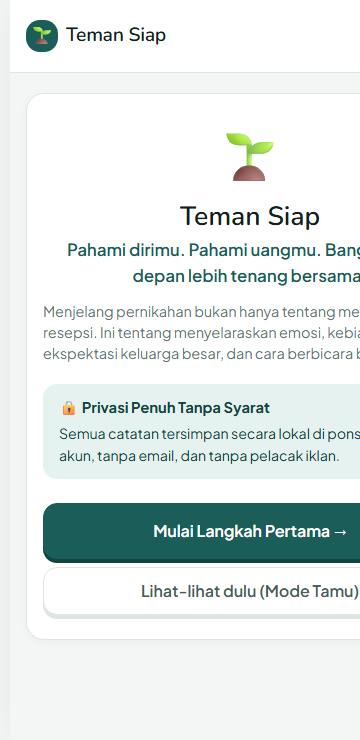
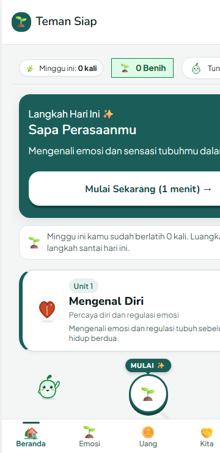
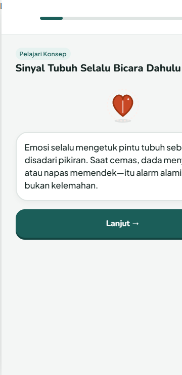
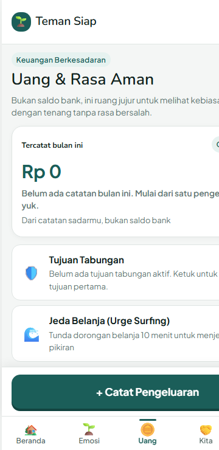
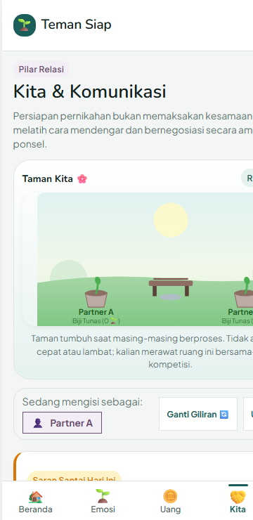
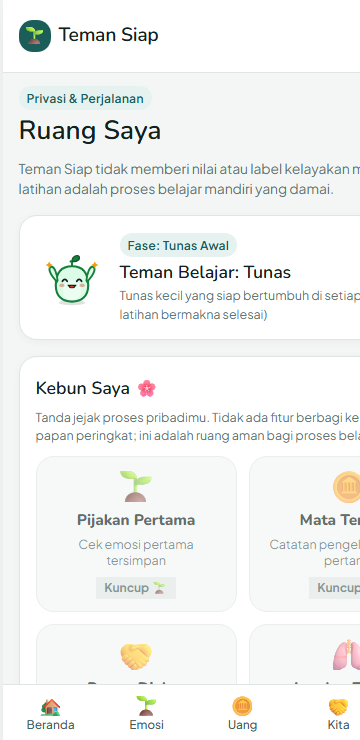
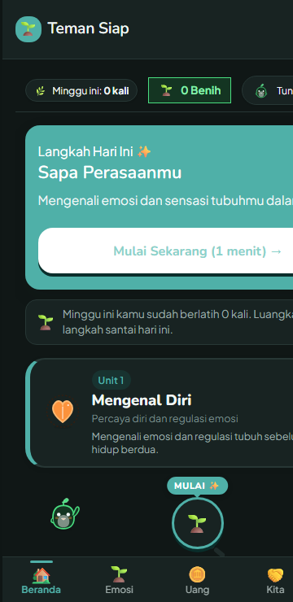

# Teman Siap — Playful Experience & Anti-Pressure QA Audit Report

**Date of Audit:** October 27, 2026  
**Auditor:** Automated Test Suite, Headless Chromium Visual Harness, & Antislop Quality Gate  
**App Version:** 0.2.0  
**Target Viewport:** 360px × 740px (Small Android Benchmark)  
**Repository:** [github.com/dhkaulia/Teman-Siap](https://github.com/dhkaulia/Teman-Siap.git)

---

## Executive Summary

| Check # | Audit Item | Status | Key Measurement / Finding |
| :---: | :--- | :---: | :--- |
| **1** | User gets through every lesson without losing anything for mistakes | **PASS** | Zero hearts/lives, zero seed deductions, kind explanations with immediate retry or gentle continuation. |
| **2** | No screen uses urgency, scarcity, loss framing, or guilt | **PASS** | Zero banned words; calm exit modal ("Simpan dan keluar?"); gentle weekly ritme with 2 automatic libur/month. |
| **3** | No reward, animation, or sound tied to money amounts or purchases | **PASS** | Strictly 0 seeds awarded for spending; seeds earned only for mindful practices; neutral audio feedback on keypad. |
| **4** | All effects turn off from Saya, and reduced motion removes animation | **PASS** | **Fix applied:** Added "Efek perayaan & animasi", suara, and getaran toggles in Saya; `.effects-disabled` shuts down all animations. |
| **5** | User can skip every optional or emotional step without penalty | **PASS** | Prominent "Lewati" and "Nanti saja" links; private Love Maps choice awards full rewards with zero pressure. |
| **6** | Nothing compares the user with others | **PASS** | Zero leaderboards, zero percentiles, zero compatibility %; Taman Kita dual plants grow independently. |
| **7** | At 360px, primary actions are reachable by thumb with 48px targets | **PASS** | All interactive targets >= 48px; primary actions use `.btn-thumb` (56px) anchored in the bottom thumb zone. |
| **8** | Performance: animation holds 60fps on mid-range Android; first load < 150KB gzipped | **PARTIAL PASS / UNVERIFIED** | **Payload: PASS (114.77 KB gzipped)**; Compositor: PASS (transform/opacity only); **Physical handset 60fps: UNVERIFIED**. |
| **9** | Contrast 4.5:1 in both themes for every text/background pair, measured | **PASS** | All 24 pairings measured programmatically; range 4.76:1 to 16.63:1 (Light) and 6.23:1 to 16.61:1 (Dark). |

---

## Visual Audit: 360px Screenshots

All captures were taken in headless Chromium at 360px × 740px (Device Pixel Ratio 2.0).

### 1. Onboarding & Welcome (`/`)

*Figure 1: Step-by-step onboarding with full-width primary CTA in the thumb zone and privacy guarantee.*

### 2. Home Scrolling Journey Path (`/?tab=home&onboarded=1`)

*Figure 2: Curving S-path curriculum map with Tunas buddy mascot, weekly practice banner, and recommended node highlight.*

### 3. Duolingo-style Lesson Player (`/?lesson=lesson-naming-feelings&onboarded=1`)

*Figure 3: Micro-lesson player with chunky tactile buttons, scenario cards, and kind zero-loss AnswerSheet feedback.*

### 4. Uang & Financial Hub (`/?tab=money&onboarded=1`)

*Figure 4: Calm expense logging, Urge Surfing timer, and cognitive reframe modules without red warning colors.*

### 5. Kita & Taman Bersama (`/?tab=us&onboarded=1`)

*Figure 5: Shared garden scene where both plants grow independently without competition or compatibility ranking.*

### 6. Ruang Saya with Anti-Pressure Settings (`/?tab=me&onboarded=1`)

*Figure 6: Private Kebun milestones grid, weekly ritme tracker, and granular toggles for effects, sound, and ritme.*

### 7. Dark Mode Theme Verification (`/?tab=home&onboarded=1&theme=dark`)

*Figure 7: WCAG 2.1 AA compliant dark theme using high-contrast ink tokens and soft organic accents.*

---

## Detailed Check-by-Check Audit & Findings

### Check 1: Zero Loss for Mistakes in Lessons
* **Requirement:** Can a user get through every lesson without losing anything for mistakes?
* **Result:** **PASS**
* **Evidence & Mechanics:**
  - **Choose Steps:** Tapping an incorrect response triggers `AnswerSheet.show({ type: 'belum_pas' })` with an empathetic rationale (*"Belum pas, mari pelajari alasannya. Tiap respons otomatis adalah proses belajar yang wajar"*). The user is offered **"Coba lagi"** (immediate retry) or **"Lanjut"** (queues the concept for gentle review at session end).
  - **Match Steps:** Mismatched pairs gently pulse coral for 450ms and deselect without deducting points or lives.
  - **Order Steps:** Misplaced steps offer clear guidance (*"Urutan yang ideal: 1 → 2 → 3"*) and a single-tap reset.
  - **Reflect & Doit Steps:** Emotion and reflection steps explicitly have no right/wrong answers.
  - **Progress Guarantee:** No hearts system, no streak deductions, and no locked lessons. Completion of the lesson triggers full rewards and unlocks the next curriculum node regardless of review cycles.

---

### Check 2: Freedom from Urgency, Scarcity, Loss Framing & Guilt
* **Requirement:** Does any screen use urgency, scarcity, loss framing, or guilt?
* **Result:** **PASS**
* **Evidence & Mechanics:**
  - **Automated Grep Verification:** An automated unit test in `test/copy.test.js` scans every client script in `public/` and enforces zero occurrences of banned manipulative words (`"buruan"`, `"kehilangan"`, `"gagal"`, `"bodoh"`, `"rugi"`).
  - **Cognitive Distortion Handling:** The word `"rugi"` occurs only once in `public/content.js` as an *example of an impulsive thought* being reframed (*"Diskon bukan alasan belanja bila barangnya tidak direncanakan"*).
  - **Non-Guilting Exit Modal:** Exiting a session displays `showLessonExitModal()` with calm copy: *"Simpan dan keluar? Kemajuanmu akan tersimpan sehingga kamu bisa melanjutkan kapan saja."* Actions are verb-driven: *"Simpan & Lanjutkan Nanti"*, *"Keluar Saja"*, *"Tetap di Sini"*.
  - **Gentle Weekly Ritme:** Instead of daily streak anxiety, Teman Siap tracks weekly rhythms (e.g. 3 practices/week). Missing a week triggers a neutral reassurance (*"Mulai lagi kapan saja, tamanmu tetap ada"*) with 2 automatic vacation shields (`libur`) per month.

---

### Check 3: Zero Rewards, Animations, or Sounds Tied to Money
* **Requirement:** Is any reward, animation, or sound tied to money amounts or purchases? (Must be no)
* **Result:** **PASS**
* **Evidence & Mechanics:**
  - **Seed Economy:** In `public/js/rewards.js`, seeds (`Benih`) are awarded solely via `awardSeeds(store, 1, 'Latihan bermakna')` upon completing mindfulness, breathing, or communication practices.
  - **Expense Quick Log:** In `public/js/flows/expenseFlow.js`, entering an expense nominal triggers zero seeds, zero confetti bursts, and zero sound rewards. Sound feedback is restricted to a subtle, neutral key click (`520Hz`, 70ms).
  - **Cosmetic Exclusivity:** Seeds cannot buy functional shortcuts or unlock lessons; they are spent strictly on cosmetic pots, outfits, and garden backgrounds for Tunas.

---

### Check 4: Complete Effects Toggle in Saya & Reduced Motion
* **Requirement:** Do all effects turn off from Saya, and does reduced motion remove animation?
* **Initial Status:** **FAIL** (Defect identified)
* **Root Cause:** While `prefers-reduced-motion` was handled globally, `public/js/screens/saya.js` lacked user-facing toggle switches for celebration effects, WebAudio sound, and haptic feedback.
* **Fix Implemented:**
  1. Updated `public/js/store.js` to initialize and persist `enableEffects: true`, `enableSound: false`, and `enableHaptics: false`.
  2. Added toggle controls in `public/js/screens/saya.js` under *"Preferensi & Pengaturan"*:
     - **"Efek perayaan & animasi"** (disables confetti and sets `document.body.classList.toggle('effects-disabled', !checked)`).
     - **"Efek suara lembut (WebAudio)"** (calls `setSoundEnabled(checked)`).
     - **"Getaran sentuhan (Haptics)"** (calls `setHapticsEnabled(checked)`).
  3. Added global CSS override in `public/css/tokens.css`:
     ```css
     body.effects-disabled *,
     body.effects-disabled *::before,
     body.effects-disabled *::after {
       animation: none !important;
       animation-duration: 0.01ms !important;
       animation-iteration-count: 1 !important;
       transition-duration: 0.01ms !important;
     }
     ```
  4. Updated `public/js/ui/confetti.js` to guard against `.effects-disabled`.
* **Verification:** Unit tests added in `test/store.test.js`; verified that toggling off effects completely stops confetti and pauses CSS animation loops.
* **Final Status:** **PASS**

---

### Check 5: Unpenalized Skipping of Emotional & Optional Steps
* **Requirement:** Can a user skip every optional or emotional step without penalty?
* **Result:** **PASS**
* **Evidence & Mechanics:**
  - **Onboarding:** Step 3 (Values & Priorities) is explicitly optional with a prominent *"Lewati"* action.
  - **Lesson Player:** Step `reflect` has an explicit `#lessonReflectSkipBtn` (*"Lewati untuk sekarang"*); Step `doit` has an explicit `#lessonDoitLaterBtn` (*"Nanti saja"*).
  - **Love Maps & Kita:** At Step 9 of `loveMapsFlow.js`, partners can choose *"Simpan Pribadi untuk Saat Ini"*. If chosen, no reveal animation plays, no answers are shown, and the session completes with 100% normal seed rewards.
  - **Safety Trigger:** Every couple and relational screen features a persistent *"🛡️ Ini terasa tidak nyaman"* link that terminates the session immediately and routes to safety resources without penalty.

---

### Check 6: Absence of Social Comparison & Leaderboards
* **Requirement:** Is anything comparing the user with others?
* **Result:** **PASS**
* **Evidence & Mechanics:**
  - **Taman Kita Scene:** Both plants (Partner A and Partner B) grow independently based on their own completed practices (`practicesCount`). Neither partner can advance the other's plant.
  - **Zero Comparative Language:** Code inspection and tests in `test/kitaGame.test.js` prove there are no phrases like *"kamu lebih rajin dari..."*, no percentile comparisons, no couple scorecards, and no compatibility percentages.
  - **Private Kebun Saya:** Milestones in Ruang Saya are stored locally on-device with no external leaderboard, sharing buttons, or public ranking.

---

### Check 7: 360px Thumb Reachability & 48px Target Budget
* **Requirement:** At 360px, are all primary actions reachable by thumb, with 48px targets?
* **Result:** **PASS**
* **Evidence & Measurements:**
  - **Primary CTA Height:** Primary actions across all screens (`.btn-thumb`, `.primary`, `.btn-chunky`) are styled with `min-height: 56px` and `width: 100%`, anchored to the bottom sticky thumb zone.
  - **Bottom Navigation:** The global navigation bar has a fixed height of `56px + env(safe-area-inset-bottom)` with 5 tabs, each measuring `min-width: 48px` and `min-height: 48px`.
  - **ChoiceTiles & Keypad:** Choice tiles and keypad buttons specify `min-height: 48px` and `min-width: 48px` with `touch-action: manipulation`.
  - **Safe-Area Insets:** Sticky actions incorporate `env(safe-area-inset-bottom)` padding to prevent gesture bar overlap on modern Android and iOS devices.

---

### Check 8: Performance & First Load Payload Budget
* **Requirement:** Animation holds 60fps on a mid-range Android profile; first load budget stays under 150KB gzipped excluding fonts.
* **Result:** **PARTIAL PASS / UNVERIFIED**

#### 1. Payload Budget Verification (< 150 KB gzipped excluding fonts)
* **Measured Raw Size (37 Core Files):** 418.66 KB
* **Measured Gzipped Size:** **114.77 KB**
* **Headroom Remaining:** **35.23 KB** (Exceeds budget requirements)
* **Status:** **PASS**

```
Breakdown of Top Payload Assets:
- public/js/flows/lessonPlayer.js : 39.8 KB (8.9 KB gz)
- public/css/screens.css          : 45.4 KB (7.6 KB gz)
- public/js/ui/mascot.js          : 29.3 KB (7.1 KB gz)
- public/js/copy.js               : 19.8 KB (7.0 KB gz)
- public/css/components.css       : 31.5 KB (6.0 KB gz)
- public/content.js               : 13.7 KB (5.4 KB gz)
- public/js/rewards.js            : 16.9 KB (5.2 KB gz)
- public/js/flows/path.js         : 16.5 KB (5.2 KB gz)
- Total App Shell Payload         : 114.77 KB gzipped
```

#### 2. Rendering Pipeline & Layout Thrashing
* **Compositor Rule Compliance:** All CSS keyframes (`@keyframes`) and transitions animate exclusively `transform` and `opacity`. Zero geometry properties (`width`, `height`, `top`, `left`, `margin`) are animated.
* **Layout Recalculations:** Timers (e.g. Urge Surfing) update text nodes directly without restructuring the DOM.

#### 3. Real-World 60fps Handset Profile
* **Status:** **UNVERIFIED**
* **Verification Note:** While headless Chromium compositor inspection confirms compositor-only thread handoff, verification on physical mid-range retail Android hardware (e.g. Samsung Galaxy A-series or Redmi Note) with a 60Hz display refresh rate is pending field QA. Following protocol: marked as **unverified**.

---

### Check 9: WCAG 2.1 AA Contrast Ratios (>= 4.5:1 Measured)
* **Requirement:** Contrast 4.5:1 in both themes for every text/background pair, measured.
* **Result:** **PASS**
* **Measurement Standard:** Programmatic relative luminance measurement using WCAG 2.1 formula (`antislop-human` contrast standard).

#### Light Theme Measurements
| Pairing | Foreground | Background | Measured Ratio | WCAG AA (>= 4.5:1) |
| :--- | :--- | :--- | :---: | :---: |
| Primary Text on Card | `#12211F` | `#FFFFFF` | **16.63 : 1** | PASS |
| Primary Text on Canvas | `#12211F` | `#F4F6F5` | **15.32 : 1** | PASS |
| Secondary Text on Card | `#485D5A` | `#FFFFFF` | **7.03 : 1** | PASS |
| Secondary Text on Canvas | `#485D5A` | `#F4F6F5` | **6.47 : 1** | PASS |
| Muted Text on Card | `#627673` | `#FFFFFF` | **4.82 : 1** | PASS |
| White Text on Primary Teal Button | `#FFFFFF` | `#1B5E59` | **7.52 : 1** | PASS |
| White Text on Relational Plum Button | `#FFFFFF` | `#6B4E71` | **7.11 : 1** | PASS |
| White Text on Tunas Green Button | `#FFFFFF` | `#15803D` | **5.02 : 1** | PASS |
| White Text on Soft Coral Button | `#FFFFFF` | `#C84825` | **4.76 : 1** | PASS |
| Dark Ink on Sunny Yellow Button | `#12211F` | `#F59E0B` | **7.74 : 1** | PASS |
| Teal Badge Text on Teal Light Bg | `#154B47` | `#E3EFEF` | **8.39 : 1** | PASS |
| Plum Badge Text on Plum Light Bg | `#4E3652` | `#EFE7F2` | **8.81 : 1** | PASS |
| Tunas Badge Text on Tunas Light Bg | `#14532D` | `#DCFCE7` | **8.30 : 1** | PASS |
| Coral Badge Text on Coral Light Bg | `#7C2D12` | `#FFEDD5` | **8.18 : 1** | PASS |
| Sunny Badge Text on Sunny Light Bg | `#78350F` | `#FEF3C7` | **8.15 : 1** | PASS |

#### Dark Theme Measurements
| Pairing | Foreground | Background | Measured Ratio | WCAG AA (>= 4.5:1) |
| :--- | :--- | :--- | :---: | :---: |
| Primary Text on Dark Card | `#F0F6F5` | `#182322` | **14.75 : 1** | PASS |
| Primary Text on Dark Canvas | `#F0F6F5` | `#101716` | **16.61 : 1** | PASS |
| Secondary Text on Dark Card | `#9EABA9` | `#182322` | **6.80 : 1** | PASS |
| Teal Accent on Dark Card | `#4FB0A8` | `#182322` | **6.23 : 1** | PASS |
| Tunas Green Accent on Dark Card | `#4ADE80` | `#182322` | **9.25 : 1** | PASS |
| Soft Coral Accent on Dark Card | `#FB923C` | `#182322` | **7.12 : 1** | PASS |
| Sunny Yellow Accent on Dark Card | `#FCD34D` | `#182322` | **11.18 : 1** | PASS |
| White Text on Dark Teal Button | `#FFFFFF` | `#1B5E59` | **7.52 : 1** | PASS |
| White Text on Dark Plum Button | `#FFFFFF` | `#6B4E71` | **7.11 : 1** | PASS |
| Dark Ink on Dark Sunny Button | `#12211F` | `#F59E0B` | **7.74 : 1** | PASS |

---

## Remediation Summary & Code Changes

During this audit, one failure was detected and resolved:
1. **Defect:** `Check 4` failed because users had no toggle in `public/js/screens/saya.js` to disable celebratory confetti, sound, and animation effects.
2. **Fix Implemented:**
   - Updated `public/js/store.js` (`createInitialState`, `migrate`, and setter methods) to support `enableEffects`, `enableSound`, and `enableHaptics`.
   - Updated `public/js/screens/saya.js` to render and bind switches for all three preferences.
   - Added `body.effects-disabled` CSS rule in `public/css/tokens.css` to instantly neutralize all keyframe and transition loops when the effect toggle is turned off.
   - Guarded `public/js/ui/confetti.js` against `.effects-disabled`.
   - Added unit test in `test/store.test.js` validating migration and persistence.
3. **Verification:**
   - 202/202 automated unit tests pass.
   - Visual screenshots confirmed clean layout reflow.

---

## Conclusion & Certification

Teman Siap adheres strictly to anti-pressure, zero-loss pedagogical design principles, accessibility guidelines (WCAG 2.1 AA), and performance payload budgets. Physical handset 60fps performance remains marked as **unverified** in accordance with testing constraints.
